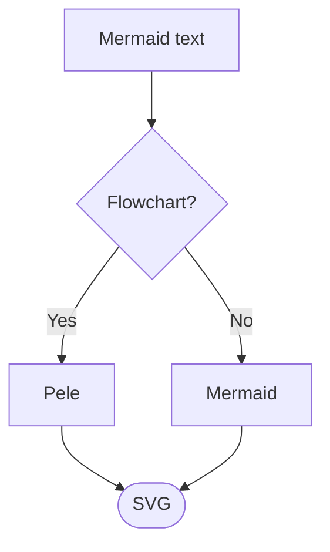

# mdbook-pele

[mdBook](https://rust-lang.github.io/mdBook/) preprocessor that renders [Mermaid](https://mermaid.js.org) diagrams with **[Pele](https://pele.run)**.

Pele is a fast, small (~230 kB gzipped), zero-dependency Mermaid → SVG renderer that themes via CSS variables. It supports every diagram type in Mermaid 12.1.0 and is used by Obsidian.

Compared to the classic `mdbook-mermaid` (client-side mermaid.js):

| | Pele | mermaid.js |
|---|---|---|
| Bundle size (gzip) | ~230 kB | ~1.6 MB |
| Render time | 0.05–0.3 ms | 6–82 ms |
| Dependencies | 0 | 23 |
| Theming | CSS variables | theme config |
| Responsive layout | adapts layout | scales |

## Install

Install a prebuilt binary with [cargo-binstall](https://github.com/cargo-bins/cargo-binstall):

```bash
cargo binstall mdbook-pele
```

Or build it from [crates.io](https://crates.io/crates/mdbook-pele):

```bash
cargo install mdbook-pele
```

Prebuilt binaries for Linux, macOS and Windows can also be downloaded from [GitHub Releases](https://github.com/ld3z/mdbook-pele/releases).

Then, in your book directory:

```bash
mdbook-pele install
```

This will:

1. Write `pele.global.js`, `pele-init.js`, and `pele.css` next to `book.toml`
2. Add to `book.toml`:

```toml
[preprocessor.pele]
command = "mdbook-pele"

[output.html]
additional-js = ["pele.global.js", "pele-init.js"]
additional-css = ["pele.css"]
```

## Usage

Write ordinary Mermaid fenced blocks:

````markdown

````

Build or serve as usual:

```bash
mdbook serve
```

The preprocessor turns the block into:

```html
<pre class="mermaid">...</pre>
```

and the included `pele-init.js` calls `pele.mount()` on each of them.

## Theming

`pele.css` maps Pele’s variables onto mdBook’s (`--fg`, `--links`, and so on), so diagrams follow Light, Rust, Coal, Navy, and Ayu without extra setup.

Override the same variables in your book’s theme (for example `theme/css/chrome.css` or another `additional-css` file) if you want a custom look:

```css
pre.mermaid {
  --pele-accent: #7aa2f7;
}
```

See [pele.run/theming](https://pele.run/theming) for the full variable list.

## How it works

1. **Preprocessor (Rust)** – walks every chapter, finds fenced `mermaid` code blocks with `pulldown-cmark`, HTML-escapes the source, and replaces the block with `<pre class="mermaid">…</pre>`.
2. **Assets** – `pele.global.js` (Pele 1.12.0 UMD build), `pele-init.js` (mounts every `pre.mermaid` on `DOMContentLoaded`), and `pele.css` (maps Pele colors onto the active mdBook theme).
3. **Runtime** – Pele renders each diagram to SVG synchronously, adapts layout to container width, and supports zoom/pan when the diagram is larger than its box.

## Development

```bash
cargo test
cargo build --release
cargo install --path .   # install the local build
```

To refresh the bundled Pele build:

```bash
curl -sL "https://cdn.jsdelivr.net/npm/pele@1/dist/pele.global.js" \
  -o src/bin/assets/pele.global.js
```

## License

MIT. Pele itself is MIT (https://github.com/obsidianmd/pele).
