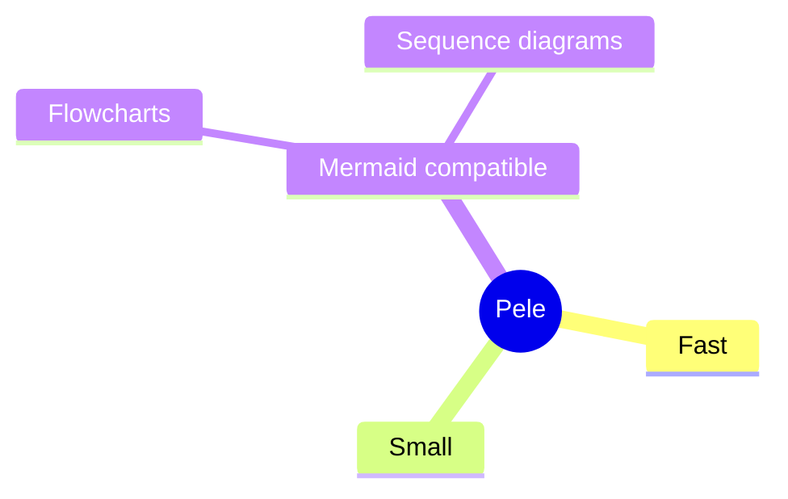
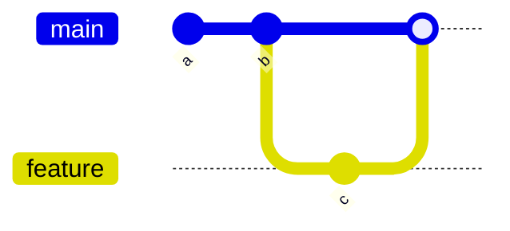
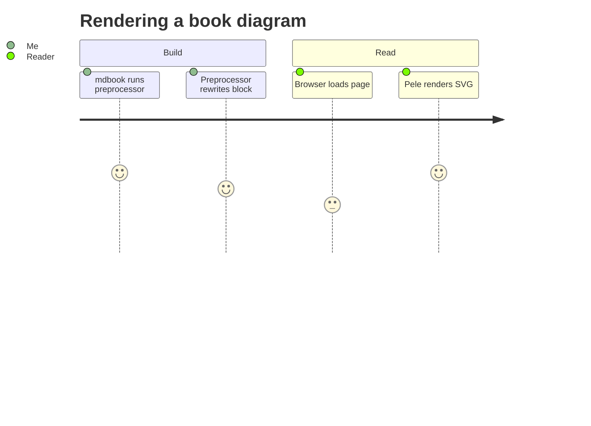

# Supported Diagram Types

Pele ships with parsers for every diagram type in Mermaid 12.1.0. Detection is based on the first line of the diagram, so use the exact keywords below as the first token of your block.

## Core diagram types

| Keyword | Diagram |
|---|---|
| `graph`, `flowchart` | Flowchart (v2 layout) |
| `flowchart-elk` | Flowchart with the ELK layout engine |
| `sequenceDiagram` | Sequence diagram |
| `classDiagram` | Class diagram |
| `stateDiagram` | State diagram (v2) |
| `erDiagram` | Entity-relationship diagram |
| `gantt` | Gantt chart |
| `pie` | Pie chart |
| `gitGraph` | Git graph |
| `journey` | User journey diagram |
| `timeline` | Timeline |
| `mindmap` | Mindmap |
| `quadrantChart` | Quadrant chart |
| `requirementDiagram` | Requirements diagram |
| `kanban` | Kanban board |
| `sankey-beta` / `sankey` | Sankey diagram |
| `xychart-beta` / `xychart` | XY chart |
| `block-beta` / `block` | Block diagram |
| `packet-beta` / `packet` | Packet diagram |
| `architecture` | Architecture diagram |
| `info` | Info diagram |
| `treemap` | Treemap |
| `ishikawa` | Ishikawa (fishbone) diagram |
| `eventmodeling` | Event modeling diagram |

## Extended and beta types

| Keyword | Diagram |
|---|---|
| `C4Context`, `C4Container`, `C4Component`, `C4Dynamic`, `C4Deployment` | C4 (architecture) diagrams |
| `agentflow-beta` | Agent flow |
| `swimlane-beta` | Swimlane |
| `treeView-beta` | Tree view |
| `radar-beta` | Radar chart |
| `venn-beta` | Venn diagram |
| `wardley-beta` | Wardley map |
| `cynefin-beta` | Cynefin framework diagram |
| `usecase-beta` | Use case diagram |
| `railroad-beta`, `railroad-ebnf-beta`, `railroad-abnf-beta`, `railroad-peg-beta` | Railroad / syntax diagrams |

## Behavior on unknown input

- If the first line does not match any known type, Pele falls back to parsing the text as ordinary [Mermaid flowchart syntax](#core-diagram-types) (`graph`/`flowchart`).
- Syntax errors raise a `PeleError` that reports the offending line, column, and a snippet pointing at the problem; in the browser this appears in the console and the diagram element is left as-is rather than replacing the page with a broken render.

## Examples

A few of the more distinctive types:

