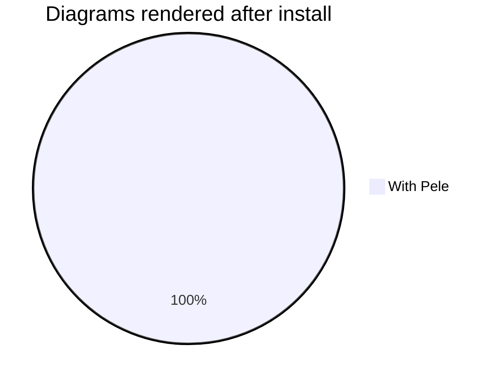

# Getting Started

## Prerequisites

- [mdBook](https://rust-lang.github.io/mdBook/) 0.4 or later (the preprocessor talks the standard preprocessor protocol)
- A book with a `book.toml`

## Install the preprocessor

Install a prebuilt binary with [cargo-binstall](https://github.com/cargo-bins/cargo-binstall):

```bash
cargo binstall mdbook-pele
```

Or build it from [crates.io](https://crates.io/crates/mdbook-pele):

```bash
cargo install mdbook-pele
```

Prebuilt binaries for Linux, macOS and Windows can also be downloaded from [GitHub Releases](https://github.com/ld3z/mdbook-pele/releases).

## Set up your book

Run this in your book directory (the directory containing `book.toml`):

```bash
mdbook-pele install
```

This does two things:

1. Writes the browser-side assets next to `book.toml`:
   - `pele.global.js` — the Pele runtime
   - `pele-init.js` — mounts every diagram on page load
   - `pele.css` — maps Pele's colors onto the active mdBook theme
2. Updates `book.toml` with:

```toml
[preprocessor.pele]
command = "mdbook-pele"

[output.html]
additional-js = ["pele.global.js", "pele-init.js"]
additional-css = ["pele.css"]
```

The command can be re-run safely: it never adds duplicate entries to `book.toml`. Be careful though — it *will* overwrite the asset files (`pele.global.js`, `pele-init.js`, `pele.css`), so re-run it only when you actually want to refresh them; customizations like theming overrides live in your own CSS files, not these.

## Build

```bash
mdbook build
# or, for live preview while writing:
mdbook serve
```

Any fenced ```` ```mermaid ```` block is now rendered as an SVG by Pele. Try one:



## Manual setup (without `install`)

You can skip the `install` command and configure everything by hand:

1. Copy `src/bin/assets/` from the [repository](https://github.com/ld3z/mdbook-pele) (`pele.global.js`, `pele-init.js`, `pele.css`) into your book directory.
2. Add the `[preprocessor.pele]` and `[output.html]` blocks shown above to `book.toml`.

## Upgrading

Reinstall the binary (`cargo binstall mdbook-pele`, `cargo install mdbook-pele`, or download a new release) and re-run `mdbook-pele install` to refresh the bundled assets. The preprocessor is version-checked against mdBook on every build: a mismatch between the mdBook version it was built against and the one running it prints a warning.
