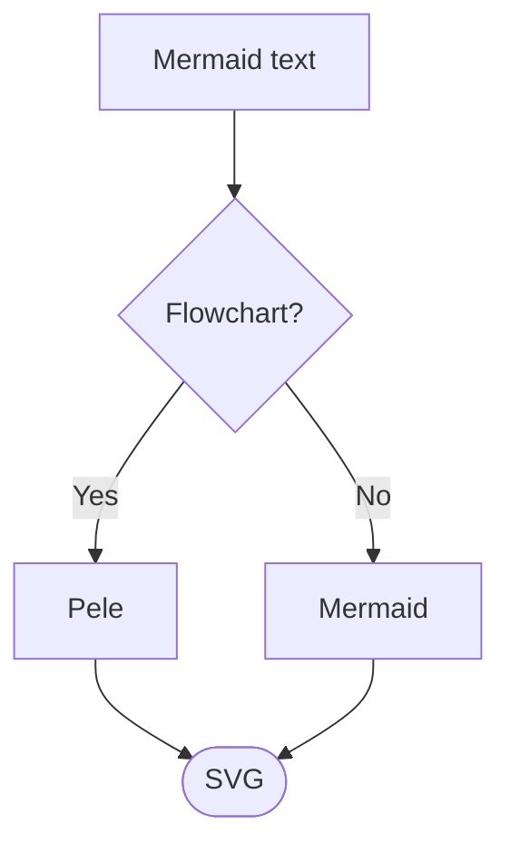

# mdbook-pele

[mdBook](https://rust-lang.github.io/mdBook/) preprocessor that renders [Mermaid](https://mermaid.js.org) diagrams with **[Pele](https://pele.run)**.

Pele is a fast, small (~230 kB gzipped), zero-dependency Mermaid → SVG renderer that themes via CSS variables. It supports every diagram type in Mermaid 12.1.0 and is used by [Obsidian](https://obsidian.md).

## Why Pele?

Compared to the classic `mdbook-mermaid` (client-side mermaid.js):

| | Pele | mermaid.js |
|---|---|---|
| Bundle size (gzip) | ~230 kB | ~1.6 MB |
| Render time | 0.05–0.3 ms | 6–82 ms |
| Dependencies | 0 | 23 |
| Theming | CSS variables | theme config |
| Responsive layout | adapts layout | scales |

## Quick example

## What's in this book

- [Getting Started](./getting-started.md) — installing the preprocessor and setting it up in a book
- [Usage](./usage.md) — writing diagrams, and what the preprocessor does to your Markdown
- [Theming](./theming.md) — how diagrams follow mdBook themes, and how to customize them
- [Supported Diagram Types](./diagram-types.md) — every diagram type Pele can render
- [Troubleshooting](./troubleshooting.md) — common problems and fixes
