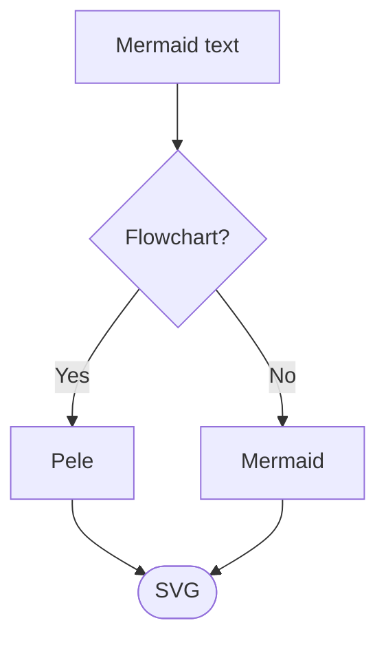
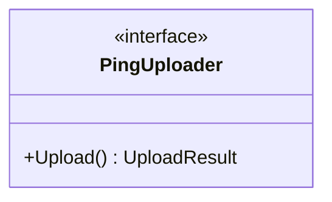

# Usage

## Writing diagrams

Write ordinary Mermaid fenced code blocks anywhere in a chapter:

````markdown

````

The same syntax the [Mermaid docs](https://mermaid.js.org/intro/) describe works as usual — at build time the fenced block becomes:

```html
<pre class="mermaid">...</pre>
```

and the bundled `pele-init.js` calls `pele.mount()` on each `pre.mermaid` element when the page loads.

## What gets transformed

- Fenced code blocks with the info string `mermaid` are replaced. Regular fenced blocks in other languages, indented code blocks, and inline code are left untouched.
- The Mermaid source is HTML-escaped (`<`, `>`, `&`, `"` become entities) so it survives embedding in `<pre>` markup — useful for things like `<<interface>>` in class diagrams.
- CRLF line endings inside a diagram are normalized to LF.
- Blocks delimited with more than three backticks work exactly like the basic form, so you can write documents that themselves contain triple-backtick fences without breaking the diagram.

Escaping only affects characters that would break HTML embedding; Mermaid decodes standard entities itself, so arrow labels like `A --> B` still render as `-->`. Diagrams may also start with Mermaid front matter (`title`, `config`) and use `%%{init: ...}%%` directives and `%%` comments as usual — Pele handles them at parse time.

## Renderer support

The preprocessor only supports the `html` renderer. If `mdbook build` is invoked with another renderer (pdf, markdown, epub, ...), the preprocessor is skipped for it and the untouched Markdown passes through. For the default HTML build this never comes up.

## Example: a class diagram with angle brackets

````markdown

````

Renders as (the `<<interface>>` survives because of the escaping step):


For a tour of every supported diagram type, see [Supported Diagram Types](./diagram-types.md).
